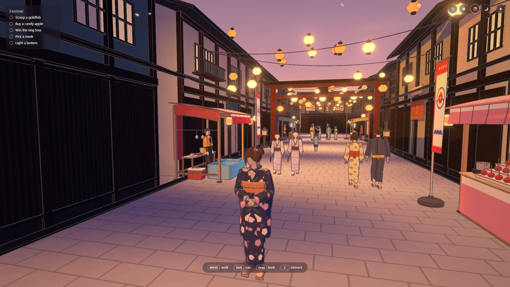
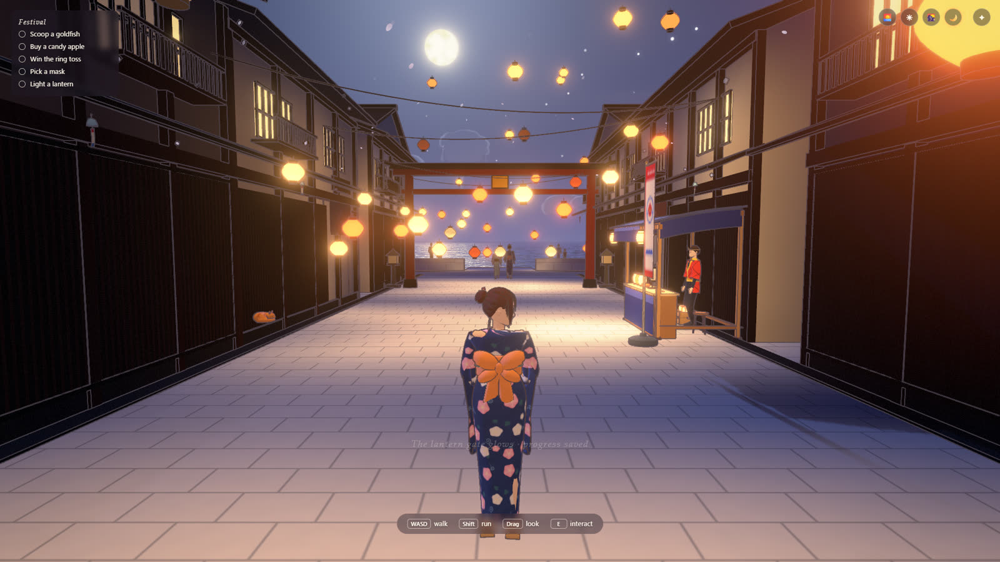
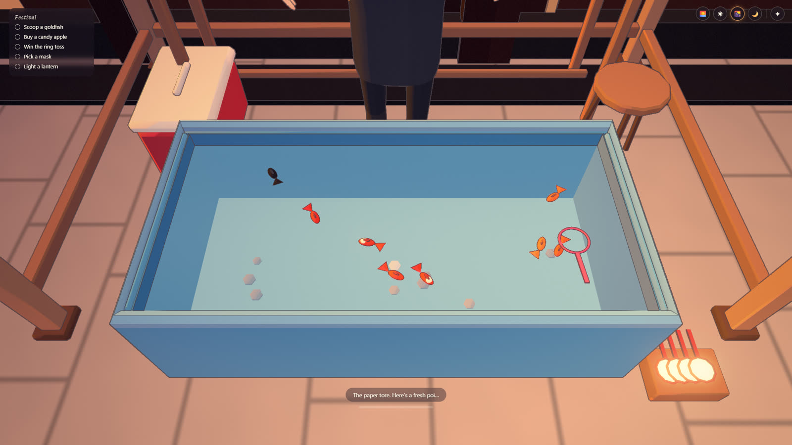
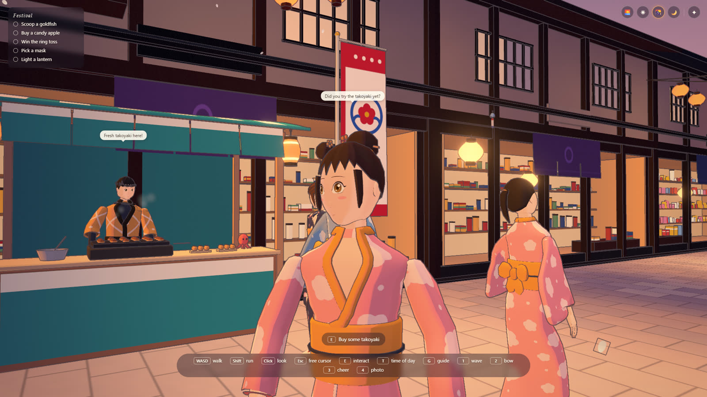
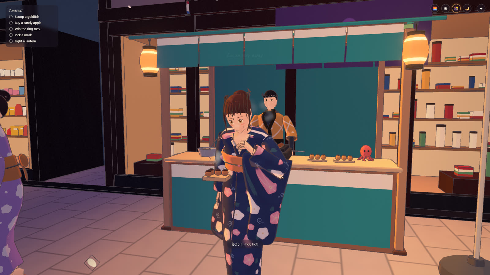
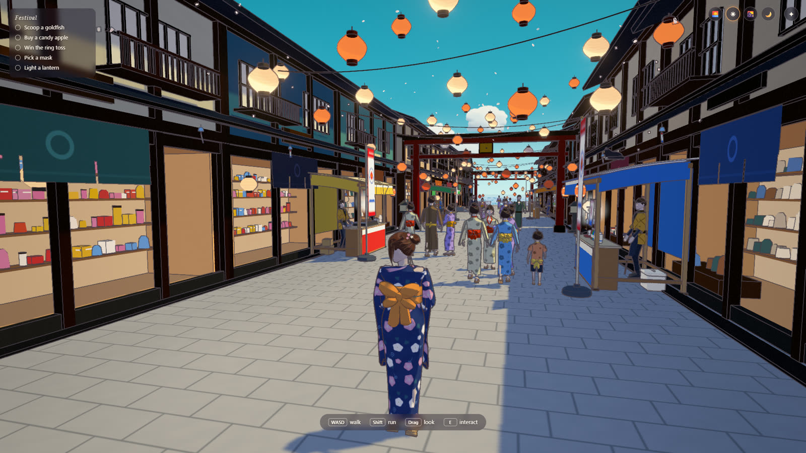
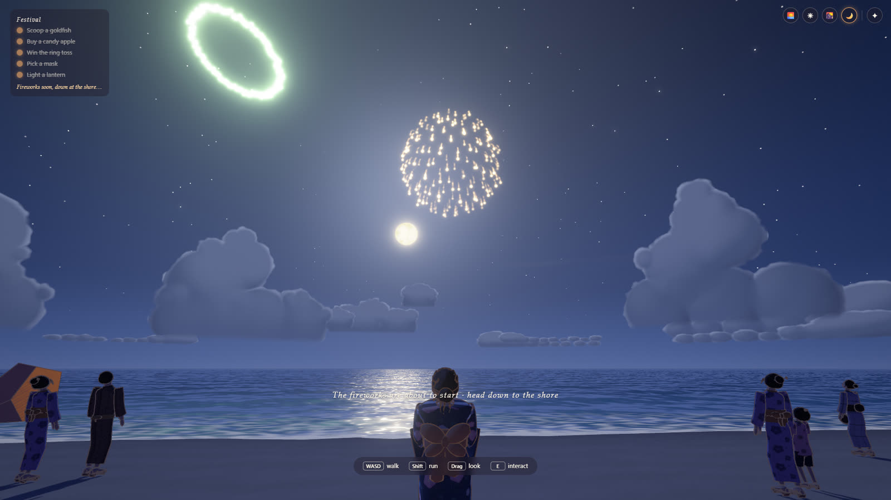

# Summer Festival

A small anime-style game in the browser: a seaside town on the night of its summer festival, walked at street level.
You play a girl in a summer yukata on a street of food and game stalls under strings of paper lanterns. She scoops a
goldfish, buys a candy apple, wins the ring toss, picks a mask and lights a lantern, and once all five are done the
fireworks go up over the sea at the end of the street. There is no score, no timer and no way to fail.

The town is busy around her. Festival-goers in yukata walk in small groups, stop to chat and sit on the benches; the
stall keepers wave and call out; a dog follows her for a while and a cat runs off under a stall. Morning, day, sunset
and night are a click away, and the lanterns glow in every light.



**Play it: https://starknightt.github.io/summer-festival/**

It needs a browser with WebGPU (current Chrome or Edge on a desktop or laptop), a keyboard and a mouse. It was built
in Chrome on Windows and measured on an RTX 4060. The first visit downloads about 11 MB.

## Running it locally

```
git clone https://github.com/StarKnightt/summer-festival.git
cd summer-festival
pnpm install
pnpm dev          # http://localhost:5441
pnpm build        # type-check, then a production build into dist/
pnpm preview      # serve dist/ on http://localhost:5440
```

You need Node.js 22 and pnpm 10. `three` (r187) is the only runtime dependency. The build uses a relative base, so
`dist/` works from any sub-path, including `/summer-festival/` on GitHub Pages; every push to `main` deploys it
through `.github/workflows/pages.yml`.



## Controls

Click the scene to capture the mouse. The first click or key also clears the title card and starts the sound.

| Input | Action |
|---|---|
| W A S D or arrows | Walk |
| Shift | Run |
| Mouse (or drag) | Look around |
| Wheel | Camera a little closer or further |
| E or Enter | Talk, play, buy, pet: whatever the prompt at the bottom says |
| 1 / 2 / 3 / 4 | Wave, bow, cheer, take a photo. People nearby react |
| G | Turn the guide (pin, edge arrow and path on the ground) off and on |
| T | Next time of day: morning, day, sunset, night |
| Esc | Free the mouse; inside a mini-game, leave it |

The round buttons at the top right do the same as T, and the small icon beside them opens the achievements. The key
bar at the bottom lists the keys while you play.

| URL option | Effect |
|---|---|
| `tod=night` | Start at `morning`, `day`, `sunset` (default) or `night` |
| `fresh` | Ignore saved progress for this visit |
| `play` | Skip the title card |
| `debug` | Print the GPU adapter in the console |



## What is in it

- **The festival tasks.** Five short mini-games, shown as a checklist at the top left: scoop a goldfish, buy a candy
  apple, win the ring toss, pick a mask and light a lantern. Each one can be played again, and the checklist keeps a
  count and your best. A soft chime and a small "task 2/5" mark each one done.
- **More to do.** Three food stalls where she orders and eats (yakisoba, takoyaki, shaved ice with a choice of
  syrup), a shooting gallery and a shrine with a lucky draw. She wears the mask she picked and carries her goldfish
  in its bag.
- **The street.** About a hundred metres of seaside town: two-storey shop fronts with noren curtains, stalls, banners
  and wind chimes in the wind, three lantern gates that light up as you pass under them and save your progress, and
  steps down from the promenade to the beach and the sea wall.
- **The finale.** With all five tasks done, the guide leads to the shore, the crowd gathers and the fireworks burst
  over the sea.
- **Achievements.** Four, popping up small and quiet: all five tasks, the three hidden cats, the fireworks and
  petting the sleeping cat.
- **Her.** Built in Blender by script: a face that reads from the front, the side and three-quarter, with blinks, a
  smile and a head that turns to look at the stalls and the people near her. Her hair, sleeves and obi bow move on
  springs. Walk and run come from Mixamo clips retargeted onto her own rig, with the stride matched to her speed so
  her feet do not slide.
- **The townspeople.** Men, women, kids and older folk in yukata, also built in Blender, with faces, blinks and
  smiles. They walk, chat in groups with speech bubbles (never more than two on screen), sit on benches and steps,
  react to her emotes and fill the shore for the fireworks. Every stall has a keeper with a face.
- **Animals.** A dog that trots after her and a cat that gallops off when she runs at it, both walking on legs placed
  by two-bone IK, plus a cat asleep on a step and three hidden ones to find.
- **Sound.** A festival band, the murmur of the crowd, the sea, the wind, wind chimes, the sizzle of the food stalls,
  footsteps on stone, wood and sand, the gate bells, the task chime and the fireworks, all synthesized in code with
  the Web Audio API.



## How it works

### Rendering

Everything is drawn with three.js's WebGPURenderer and TSL node materials. Every material from the models is
replaced on load by a toon material chosen by its name: a cel ramp with warm shadows on skin, a rim light, ink
outlines and bloom on the lanterns. The sky, the clouds, the sea, the lighting and the time of day were reused from
earlier builds (Summer Cycle, Bay Ride, Skate Park) and adapted to the toon look. Changing the time of day blends the
sky, the sun and the lantern light rather than cutting.

### Animation

Her clips play through one animation system built the way the three.js examples do it: walk, run and idle blend by
weight and share one stride phase, so the feet stay planted through a change of speed; nods, head shakes and glances
are additive layers on top; and a look-at IK turns the spine, neck and head toward what she looks at, each within its
own limit. The Mixamo clips were retargeted onto her rig and the townspeople's in Blender, with the feet planted and
the speed of each clip written into the model so the game can match it.

### No first-look freeze

Before the title card clears, every model and every material is drawn once off screen, so the GPU has compiled every
shader before you play. Without it, the first close-up at a stall froze the game for nearly three seconds.



## Performance

Measured with `node scripts/fps.mjs` on the production build in Chrome, on a Ryzen 5 7600X with an RTX 4060 at
1920x1080: about 43 fps walking down the street at sunset, 39 fps among the stalls at night and 52 fps during the
fireworks, with 99% of frames under 30 ms. The first visit downloads about 11 MB: the townspeople (4.5 MB), the heroine
(3 MB), the stalls and town props (2.8 MB), the cats and dog (0.5 MB) and 1.2 MB of code.

## Project structure

```
src/
  core/      camera, input, model preloading
  render/    sky, clouds, sea, toon materials, surfaces, post chain
  world/     the town, layout, stalls, lantern gates, cats, time of day, wind
  actors/    the heroine, the animation system, the townspeople, their moments, animals, springs
  game/      the game loop, progress, the guide, emotes and speech bubbles
  game/mg/   the mini-games: goldfish, candy apple and masks, ring toss, lantern, food, gallery, lucky draw
  fx/        fireworks, steam, sparklers and other particles
  audio/     the sound engine
  ui/        the HUD
tools/blender/   the Blender build scripts: heroine, people, stalls, cats, Mixamo retarget
scripts/         browser checks and captures (below)
```

The scripts drive the installed Chrome on the GPU; they print the adapter on every run and stop on a software
renderer. `node scripts/playtest.mjs` plays every task twice and the finale, `node scripts/extras.mjs` plays the food
stalls, the gallery, the lucky draw, the emotes and the guide, `collide.mjs` and `audit_solid.mjs` check that nobody
walks through a prop, `gait.mjs` measures foot sliding and writes walk and run strips, and `pnpm shoot` takes
screenshots.



## Limitations

- **Under 60 fps at 1080p.** On the RTX 4060 it runs at about 40 to 50 fps; the crowd and the lantern lights are the
  cost.
- **Her face is close but not finished.** The ear is a plain flat shape, and close up the lifted lower lids of the
  smile show as a slightly lighter band under the eyes.
- **The townspeople's run is a slow jog**, and some of their arm clips (eating, drinking) miss the face by a few
  centimetres.
- **Browsers and hardware.** Only Chrome on Windows with an NVIDIA GPU was tested. Firefox, Safari, macOS,
  integrated graphics and phones were not.
- **No touch controls.** It needs a keyboard and a mouse.



## How it was built

It was built with Claude Code, with the models made in Blender by Python scripts run headless. Each part was checked
in the real game on the GPU before it was committed, and bots play every task and stall on every round. The prompts
are in [PROMPTS.md](PROMPTS.md).

## Licence and credits

The game's own code is MIT. See [LICENSE](LICENSE).

The heroine, the townspeople, the stalls, the town, the animals and every texture are our own work, built in Blender
by script; nothing was downloaded. The walk, run, idle and gesture animations are from
[Mixamo](https://www.mixamo.com/) (Adobe), retargeted onto our rigs and shipped only inside the game's models, as
Mixamo's terms allow; the raw Mixamo files are not in this repository. Every sound is synthesized in code.

<a href="https://buymeacoffee.com/prasenx"></a>&nbsp;<a href="https://github.com/sponsors/StarKnightt"></a>
